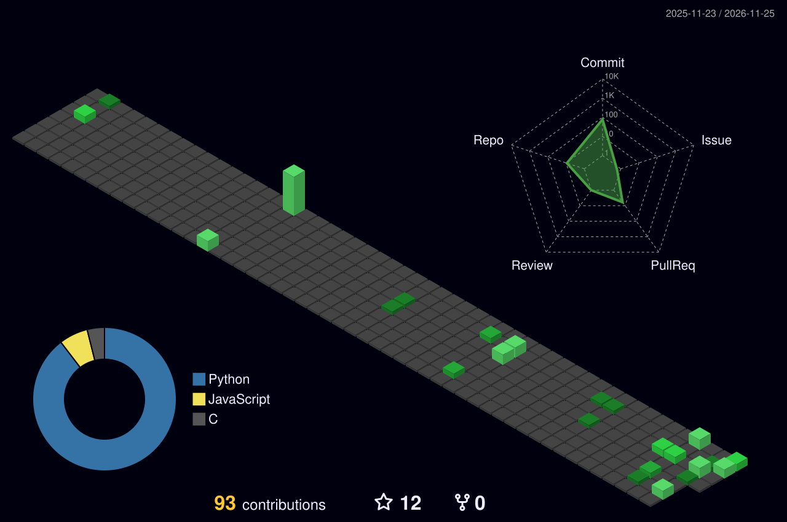

<p align="center">
  
</p>

### `0x00` &nbsp; whoami

```nasm
section .data
    name      db "Jonathan Chan", 0
    based_in  db "Toronto, ON  <->  Hong Kong", 0
    school    db "University of Toronto -- BSc CS + Mathematics, class of 2028", 0
    now       db "ML Developer @ UofT CREATE", 0
              db "Director of Academics @ Google Developer Groups on Campus", 0
    prev      db "Full-Stack Developer Intern @ SPC Pool Management, HK", 0
    speaks    db "English, Cantonese, Mandarin", 0
```

### `0x01` &nbsp; symbol_table

| addr | symbol | what it does | stack |
|:--|:--|:--|:--|
| `0x401000` | **MIDAS** | Personal multimodal AI assistant that runs three local LLMs (router, chat, vision) in 6 GB of VRAM, with 98% intent-routing accuracy on its eval harness. Reachable from iOS over Tailscale. | Python · FastAPI · SQLite · Ollama |
| `0x402000` | **ScubaStudy** | GenAI Genesis 2026 entry: upload a PDF, get AI-generated quiz questions, and fight a shared boss in real-time multiplayer. | FastAPI · React · WebSockets · OpenAI |
| `0x403000` | **Karaoke pitch model** | UofT CREATE. Predicts a singer's per-phrase pitch accuracy and recommends an optimal key. Labeled 62.5 h of karaoke audio with source separation, pitch tracking and DTW alignment. | XGBoost · scikit-learn · Demucs · PESTO |
| `0x404000` | **Swim school platform** | Enrollment and e-commerce platform for a swim school with 10,000+ students: custom PHP payment gateways (bank transfer, FPS QR), EN/ZH support, WhatsApp scheduling automation. | PHP · WooCommerce · Python · Pandas |

### `0x02` &nbsp; loaded_modules

<p align="left">
  <br>
  
</p>

### `0x03` &nbsp; contribution_skyline

<p align="center">
  
</p>

### `0x04` &nbsp; syscalls

<p align="left">
  <a href="https://www.linkedin.com/in/jonathan-chan-44a660329"></a>
  <a href="mailto:jonc042906@gmail.com"></a>
</p>

<p align="center">
  
</p>
