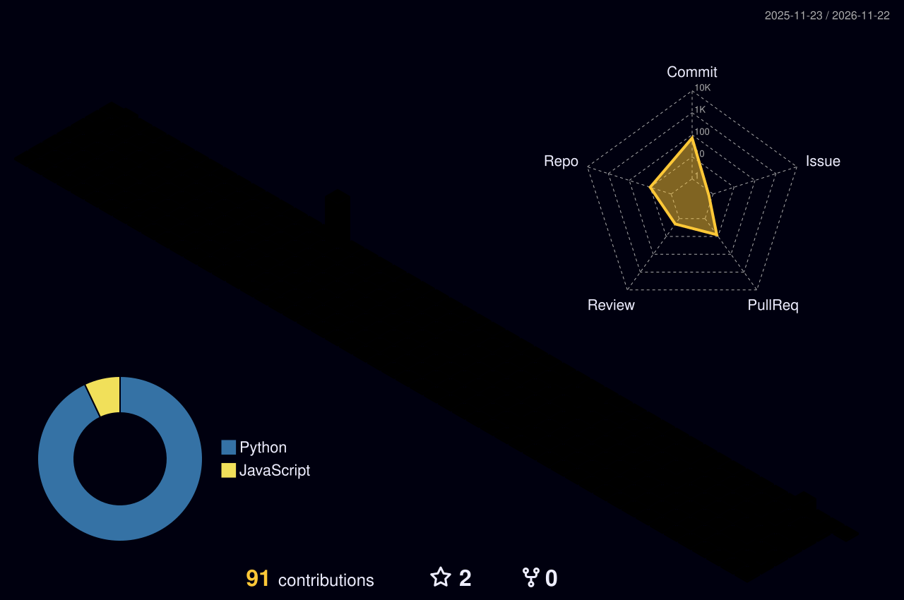

  

<h3 align="center">hey, i'm jonathan 👋</h3>

  CS + Math @ University of Toronto 
  ML Developer @ UofT CREATE &nbsp;·&nbsp; Director of Academics @ GDG on Campus UTSC 
  Toronto ⇄ Hong Kong &nbsp;·&nbsp; English · 廣東話 · 普通話

 

<h3 align="center">stack</h3>

  

 

<h3 align="center">contributions</h3>

  

 

  
  

